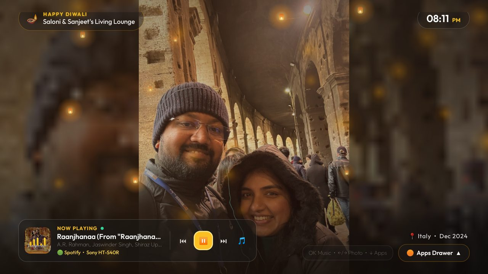

# Diwali Party Theme, with background music

An **Ambient Festive TV Dashboard** theme designed for hosting Diwali gatherings and house parties — turning the television into a warm, living photo canvas and background music station without cluttering the screen.



## Layout & Features

- **Full-Bleed Travel & Festive Memory Slideshow**: Cycles through curated travel memories and festive backdrops with gentle Ken Burns motion and subtle shadowed bottom-right location captions positioned cleanly above the Apps Drawer trigger (with no distracting pill box).
- **Warm Floating Golden Diwali Bokeh & Sky Lanterns Overlay**: Procedural golden bokeh particles and rising sky lanterns drift softly across the dark obsidian-amber canvas (`#0C0A09` background with `#F59E0B` warm gold accent glow).
- **Minimalist Top Bar**: Features a translucent `🪔 Happy Diwali` festive greeting pill on the top-left alongside a crisp 12-hour digital clock pill on the top-right.
- **Consolidated Bottom-Left Now-Playing Widget with Background Music**: Pairs a compact frosted-glass media card with 5 animated gold equalizer bars, background music support via Spotify (`com.spotify.tv.android` routed to external soundbar output), and quick **Prev / Play-Pause / Next** micro-controls for effortless D-pad track control while photos stay on screen.
- **Slide-Up 6-Column Party & Entertainment Apps Drawer**: Keeps app tiles tucked out of sight during the party slideshow; press `Down` or `M` on the remote to slide up the 6-column frosted-glass drawer (`columns: 6`, `dock_glass: true`, `dock_opacity: 50`), and press `Back` or `ESC` to dismiss it back to the unobstructed ambient view.

## What `config.json` sets

| Key | Value | Effect |
|---|---|---|
| `festival` | `"diwali"` | Enables the festive Diwali skin and greeting |
| `festival_until` | `"2026-11-15"` | Keeps the seasonal skin active through the Diwali season |
| `accent_color` | `"#F59E0B"` | Warm marigold and diya gold focus highlight and ambient glow |
| `background_color` | `"#0C0A09"` | Deep warm obsidian-charcoal base behind wallpapers |
| `columns` | `6` | Six tiles per row in the Party & Entertainment Apps Drawer |
| `dock_glass` | `true` | Frosted-glass dock and drawer surface |
| `dock_opacity` | `50` | 50% translucent glass so wallpapers and bokeh shine through |
| `ambient_glow` | `true` | Soft warm glow behind focused elements |
| `wallpaper` | `true` | Enables the theme's `wallpaper.jpg` and `wallpapers/` collection |
| `wallpaper_rotation_minutes` | `1` | Advances through the wallpaper collection every minute |
| `wallpaper_order` | `"sequential"` | Walks `wallpapers/` in filename order |
| `wallpaper_captions` | `true` | Reads scene captions from [`wallpapers/captions.txt`](wallpapers/captions.txt) |
| `wallpaper_dim` | `15` | Light 15% scrim to preserve rich golden highlights and photo contrast |
| `clock_wallpaper` | `true` | Retains the festive wallpaper behind the idle clock screensaver |
| `clock_wallpaper_dim` | `35` | Dims the backdrop by 35% during the clock screensaver |

## Wallpapers & Credits

The theme includes a primary `wallpaper.jpg` and a 3-scene rotating collection in `wallpapers/` (`01-diwali-lounge.jpg`, `02-golden-lanterns.jpg`, `03-festive-midnight.jpg`), all generated procedurally at 1920x1080 and released under **CC0 1.0**: see [`CREDITS.md`](CREDITS.md).

## Install

```bash
TV_HOST=192.168.1.50 tools/theme.sh themes/diwali-party
# Windows PowerShell
powershell -ExecutionPolicy Bypass -File tools\theme.ps1 -TvHost 192.168.1.50 themes\diwali-party
```

Undo at any time with `TV_HOST=192.168.1.50 tools/theme.sh --reset`.

## Tested on

OnePlus TV 65 Q1 (`OnePlus_TV_65_C00`, Android 9, MediaTek MT5887) with external soundbar audio output.
